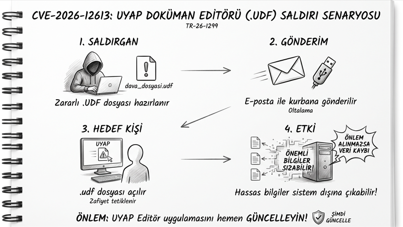

# CVE-2026-12613: UYAP Döküman Editörü Güvenlik Zafiyeti

## Genel Bakış

UYAP doküman editöründe tespit ettiğim güvenlik zafiyeti, CVE-2026-12613 kaydıyla duyurulmuştur.
UYAP Editör uygulaması, amacı dışında manipüle edilerek özel olarak hazırlanmış(!) .udf uzantılı belgeleri açarken barındırdığı zafiyet nedeniyle tehlikeli bir hal alır.

## Saldırı Senaryosu

## Referanslar

- [CVE-2026-12613 (CVE.org)](https://www.cve.org/CVERecord?id=CVE-2026-12613)
- [TR-26-1299 (Siber Güvenlik Bildirimi)](https://siberguvenlik.gov.tr/guvenlik-bildirimleri/detay/tr-26-1299)
